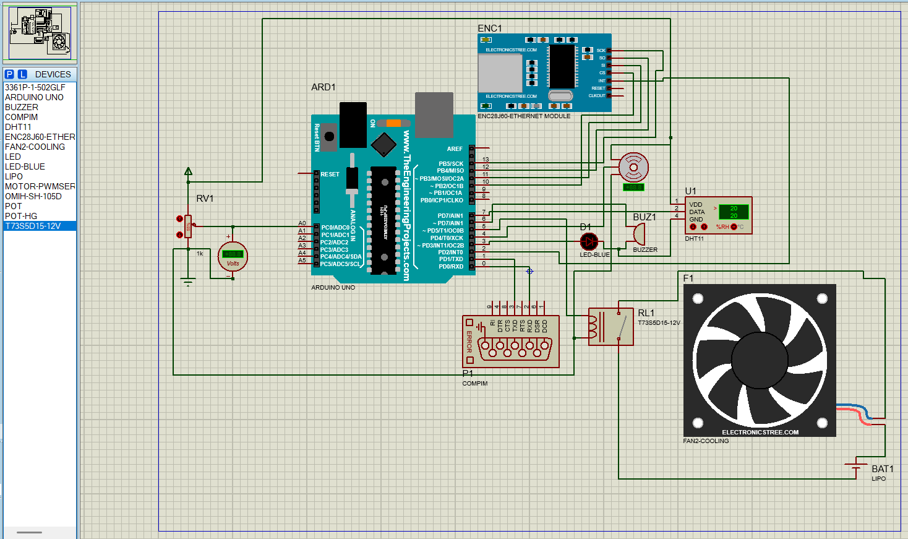

# Smart Egg Incubator – Arduino & LabVIEW

An automated egg incubator system that monitors temperature and humidity, controls cooling, and communicates real-time data to a LabVIEW dashboard through serial communication.

Built using an **Arduino Uno**, **DHT11 sensor**, **servo-controlled ventilation window**, **cooling fan**, **buzzer**, and a **potentiometer** for manual setpoint adjustment.

An optional **IoT upgrade** using the ENC28J60 Ethernet module is also included in the project documentation.



---

## 📋 Table of Contents

- [Features](#-features)
- [Components and Pinout](#-components-and-pinout)
- [How It Works](#-how-it-works)
- [Control Logic](#-control-logic)
- [LabVIEW Communication](#-labview-communication)
- [Commands Reference](#-commands-reference)
- [Project Structure](#-project-structure)
- [Installation and Setup](#-installation-and-setup)
- [Future Enhancements](#-future-enhancements)
- [License](#-license)

---

## ✨ Features

- **Temperature and humidity monitoring** using a DHT11 sensor.
- **Automatic cooling** when temperature or humidity exceeds configured thresholds.
- **Servo-controlled ventilation window** that opens and closes with the fan.
- **Adjustable temperature setpoint** using a potentiometer (25–40 °C).
- **Remote monitoring and control** through LabVIEW or any serial terminal.
- **Manual fan override** with automatic mode restoration after 10 seconds of inactivity.
- **Audible alert** using a buzzer when humidity exceeds its upper threshold.
- **Visual alert** using an LED when temperature reaches or exceeds its maximum threshold.
- **Proteus simulation support** using COMPIM for serial communication with LabVIEW.
- **Modular architecture** ready for future Ethernet and IoT integration.

---

## 🧱 Components and Pinout

| Component | Arduino Pin | Description |
|:---|:---:|:---|
| DHT11 Sensor | D7 | Temperature and humidity monitoring |
| Potentiometer | A0 | Adjusts maximum temperature (25–40 °C) |
| Overheat LED | D3 | Turns on when temperature ≥ maximum |
| Servo Motor | D4 | Controls ventilation window (0° closed, 90° open) |
| Fan Relay / MOSFET | D5 | Controls the cooling fan |
| Buzzer | D6 | Alerts when humidity is too high |
| Power Supply | 5V / GND | Arduino and sensor power |

> **Hardware safety note:** Do not connect a high-power 12V fan directly to an Arduino output pin. Use an appropriately rated relay module or MOSFET driver circuit, with a suitable external power supply.

---

## ⚙️ How It Works

1. The Arduino reads temperature and humidity from the DHT11 sensor.
2. The temperature is compared with the configured maximum temperature.
3. The humidity is compared with the configured maximum humidity.
4. The LED turns on when the temperature reaches or exceeds its maximum threshold.
5. The buzzer sounds when humidity reaches or exceeds its maximum threshold.
6. If either cooling condition is triggered, the ventilation window opens and the fan starts.
7. A hysteresis mechanism prevents rapid switching:
   - Temperature hysteresis: **3 °C**
   - Humidity hysteresis: **5%**
8. Every 2 seconds, the Arduino transmits sensor readings and system status to LabVIEW.
9. LabVIEW can send commands to modify thresholds or manually control the fan.

---

## 🌡️ Control Logic

### Temperature Control

- The maximum temperature can be configured through the potentiometer or a LabVIEW command.
- The potentiometer provides a setpoint between 25 °C and 40 °C.
- A temperature command (`T`) temporarily overrides the potentiometer setting for one data cycle.
- Sending `AUTO` restores automatic temperature control using the potentiometer.

### Fan and Ventilation Control

The fan and ventilation window operate together:

| Event | Sequence |
|:---|:---|
| Cooling starts | Window opens → Delay → Fan ON |
| Cooling stops | Fan OFF → Delay → Window closes |

### Manual Override

- Sending the `F` command toggles manual fan control.
- Manual control temporarily disables automatic cooling.
- Automatic control resumes after an `AUTO` command or a 10-second inactivity timeout.

---

## 💻 LabVIEW Communication

The Arduino communicates with LabVIEW through a serial connection.

Supported configurations:

- USB serial communication (physical Arduino).
- COMPIM virtual serial communication (Proteus simulation).
- Any compatible serial terminal.

**Serial configuration:**

| Parameter | Value |
|:---|:---|
| Baud Rate | 9600 |
| Data Bits | 8 |
| Parity | None |
| Stop Bits | 1 |

### Data Sent to LabVIEW

The Arduino sends a formatted data packet every 2 seconds.

| Field | Example | Description |
|:---|:---:|:---|
| Case Number | `case20` | Increments by 10 each transmission |
| Temperature | `31` | Current temperature (°C) |
| Humidity | `82` | Current humidity (%) |
| Temperature Status | `1` | `1` = threshold reached, `0` = normal |
| Fan Status | `1` | `1` = fan ON, `0` = fan OFF |

### Commands Reference

The following commands can be sent from LabVIEW or a serial terminal.

| Command | Description | Example |
|:---|:---|:---|
| `T 30` | Sets the maximum temperature to 30 °C | `T 38` |
| `H 80` | Sets the maximum humidity to 80% | `H 65` |
| `F` | Toggles manual fan control | `F` |
| `AUTO` | Restores automatic mode using the potentiometer | `AUTO` |
| `AUTOT 35` | Restores automatic mode and sets the temperature to 35 °C for one cycle | `AUTOT 35` |

Commands are **case-insensitive** and can be combined.

For example:

```text
AUTOT 35H 70
```

This combines automatic mode activation with temperature and humidity threshold configuration.

> **Note:** The original command description also mentions `AUTOH 80T 32`. Check the Arduino command parser before relying on this exact syntax.

---

## 📂 Project Structure

The following structure represents the project files and directories.

```text
Smart-Egg-Incubator-Arduino-LabVIEW/
│
├── README.md
├── future_enhancement.png
│
├── final_project1/
│   ├── final_project1.ino
│   │
│   └── build/
│       └── (Compiled HEX files)
│
├── libraries/
│   ├── ENC28J60 Ethernet Module Library/
│   └── Fan Models Library/
│
├── Project Backups/
│   └── (Previous simulation versions)
│
├── New Project [Autosaved].pdsprj
├── Untitled 1.vi
│
└── Enregistrement 2025-12-22 233754.mp4
```

### File Descriptions

| File / Directory | Description |
|:---|:---|
| `README.md` | Project documentation |
| `future_enhancement.png` | IoT upgrade illustration |
| `final_project1/` | Main Arduino project |
| `final_project1.ino` | Arduino source code |
| `build/` | Compiled HEX files |
| `libraries/` | Additional Proteus simulation libraries |
| `Project Backups/` | Previous project versions |
| `New Project [Autosaved].pdsprj` | Proteus simulation project |
| `Untitled 1.vi` | LabVIEW interface |
| `Enregistrement 2025-12-22 233754.mp4` | Project demonstration video |

---

## 🛠️ Installation and Setup

### 1. Hardware Setup

1. Connect the components according to the pinout table.
2. Power the Arduino using USB or an appropriate external power supply.
3. Connect the Arduino to your computer through USB.
4. Ensure the fan driver circuit is correctly connected.

### 2. Arduino IDE Setup

1. Install the Arduino IDE.
2. Install the **DHT sensor library by Adafruit** through the Library Manager.
3. Ensure the Arduino Servo library is available.
4. Open the following file:

   ```text
   final_project1/final_project1.ino
   ```

5. Select:
   - Board: Arduino Uno
   - Correct COM port
6. Compile and upload the sketch.

### 3. LabVIEW Setup (Optional)

1. Open `Untitled 1.vi`.
2. Configure the VISA serial port.
3. Set the baud rate to **9600**.
4. Read and parse the incoming serial data.
5. Use VISA Write to send commands to the Arduino.

### 4. Proteus Simulation

1. Open `New Project [Autosaved].pdsprj`.
2. Verify the component connections.
3. Configure COMPIM for virtual serial communication.
4. Connect the virtual COM port to LabVIEW.
5. Start the simulation and test the monitoring and control functions.

---

## 🔮 Future Enhancements

The `future_enhancement.png` illustration outlines a possible IoT upgrade using the **ENC28J60 Ethernet module**.

Potential improvements include:

- **Remote Monitoring:** Access incubator temperature and humidity through a web interface.
- **Cloud Data Logging:** Store sensor readings using platforms such as ThingSpeak or Blynk.
- **Remote Alerts:** Send SMS or email notifications when thresholds are exceeded.
- **MQTT Integration:** Enable communication with IoT platforms and smart-home systems.
- **Smart Agriculture Integration:** Connect the incubator to a broader agricultural monitoring system.

The project includes an ENC28J60 Ethernet module library for Proteus simulation.

---

## 📄 License

No license has been specified yet.

If you intend to make this project open source, consider adding a `LICENSE` file and selecting an appropriate license, such as MIT.
